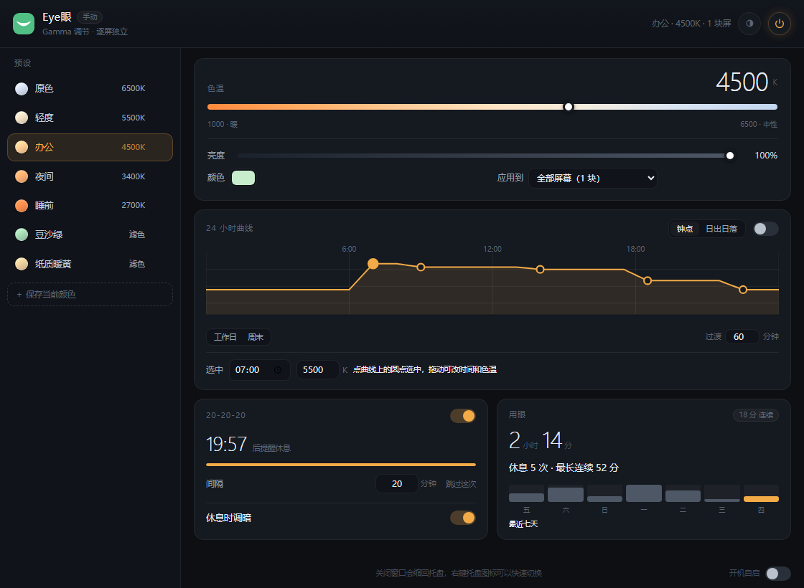

# Eye眼

[](LICENSE)
[](#已知限制)

一个用 Rust 写的 Windows 护眼工具。直接改显示器的 **Gamma 查找表**来降低色温、加滤色，
而不是在屏幕上盖一层半透明窗口——画面不会发灰，几乎不占显卡，多块显示器还能各调各的。



## 为什么不用遮罩

市面上不少护眼软件是在屏幕上铺一层半透明色板。这种做法的代价是画面整体对比度被压平，
黑色会变成深灰，而且独占全屏的游戏和视频会绕过它。

改 Gamma 表是直接改显卡输出的颜色映射曲线，属于「真的让屏幕变暖」，对比度损失小，
开销接近于零。代价是三套系统的接口完全不同，而且开了 HDR 就失效（后文有说明）。

## 功能

- **逐屏独立**：每块显示器一份独立的 Gamma 表，可以一块走 3400K、另一块走 2700K
- **预设**：内置 7 个（原色 / 轻度 / 办公 / 夜间 / 睡前 / 豆沙绿 / 纸质暖黄），
  支持把当前颜色存成具名预设，也能把不需要的移出列表，随时恢复
- **自定义**：色温 1000–6500K、亮度、任意取色
- **24 小时曲线**：一天里放多个锚点，每个锚点一个色温。锚点之间保持不变，
  临近下一个锚点才按设定的分钟数过渡，屏幕不会一整天都在缓慢变色
- **日出日落**：填经纬度，按当地太阳时间决定什么时候变暖，冬至夏至不用手动改时刻
- **工作日 / 周末**：两套曲线。周末默认跟随工作日，改一次就单独出去
- **20-20-20**：每工作 20 分钟提醒一次，休息 20 秒。到点屏幕会短暂变暖压暗，
  不打开面板也能察觉；也可以关掉，只留面板里的提示
- **用眼记录**：今天亮了多久、休息了几次、最长连续多久，保留最近 30 天
- **主题**：白天 / 黑夜 / 跟随系统
- **托盘常驻**：关窗口缩回托盘，右键快速切换预设，支持开机自启
- **异常保护**：程序被强杀或崩溃时，由看门狗进程把屏幕还原，不会卡在偏色状态

## 安装

目前只提供源码构建，还没有打包好的安装程序。

需要：

- Windows 10 / 11
- Rust 工具链（stable）
- WebView2 运行时（Windows 11 自带；Windows 10 可能需要单独安装）

```bash
git clone https://github.com/xyun2028/eyecare.git
cd eyecare

# 开发运行
cargo run -p eyecare-app

# 编译 release
cargo build --release -p eyecare-app
```

产物在 `target/release/eyecare-app.exe`。程序是绿色版，配置文件写在
`%APPDATA%\eyecare\config.json`，Gamma 备份写在 `%LOCALAPPDATA%\eyecare\last_ramp.txt`。

## 项目结构

```
app/                      Tauri 外壳：界面、托盘、调度、配置持久化
crates/eyecare-core/      色温到 Gamma 的换算、显示器抽象层（纯逻辑，可单测）
crates/eyecare-win/       Windows 后端：逐屏 Gamma、HDR 查询、开机自启、单实例
crates/eyecare-watchdog/  看门狗：主进程异常退出时还原屏幕
crates/gamma-probe/       命令行工具，真机验证和手动恢复
crates/screen-shot/       截图小工具（开发用，只截窗口尺寸或区域）
```

`eyecare-core` 不依赖任何系统接口，加 macOS / Linux 后端时这一层不用改。

## 工作原理

几个关键点，也是踩过的坑：

**逐屏生效靠独立的设备上下文**。Windows 上要用显示器的设备名（`\\.\DISPLAY1`）
单独 `CreateDCW` 取一个 DC，再写 Gamma 表。用桌面 DC 会一次改掉所有屏幕。

**改屏之前先落盘备份**。进程被强杀时没有任何清理代码能执行，唯一能救场的是提前写好的
备份文件。下次启动时如果发现它还在，就先还原再继续。

**看门狗补上最后一段**。备份文件只能等下次启动才生效，用户不重新打开程序就一直偏色。
所以另起一个极小的进程盯着主程序：主程序正常退出会删掉备份，看门狗看到备份还在，
就知道是非正常退出，直接把 Gamma 表写回去。

**HDR 会绕过 Gamma 表**。Windows 开启 HDR 后，桌面合成走的是完全不同的色彩管线，
`SetDeviceGammaRamp` 会返回成功但屏幕毫无变化。程序会读取每块屏的高级色彩状态并在界面上提示。

## 已知限制

- **仅支持 Windows**。macOS 需要 `CGSetDisplayTransferByTable`，Linux X11 需要 `XRRSetCrtcGamma`，
  两者都还没实现；Linux Wayland 没有通用接口，基本做不了。
- **HDR 开启时无效**，界面会提示。
- **独占全屏的游戏不受影响**，这是 Gamma 表被绕过的正常现象，不是 bug。
- **亮度是软件层缩放**，不是调节显示器背光，最低压到 20%。
- **日出日落要自己填经纬度**。程序不联网，也不申请定位权限，只按填进去的位置算。
- **曲线上的锚点数量固定**（新装五个，从旧版本升级上来两个），目前只能拖位置、改色温，
  还不能增删锚点。
- **用眼记录只在护眼开关打开时累加**，关掉的那段时间不算。
- 没有全局快捷键，需要的话可以加。

## 开发

```bash
cargo test                    # 全部单元测试
cargo run -p eyecare-app      # 启动应用

# 不给界面，直接验证 Gamma 行为
cargo run -p gamma-probe -- list
cargo run -p gamma-probe -- apply 4000,2700 5
cargo run -p gamma-probe -- check          # 看当前 Gamma 表峰值
cargo run -p gamma-probe -- recover        # 从上一次的备份恢复屏幕
```

改动 `app/icons/` 下的图标后，需要让构建脚本重新执行一次
（`touch app/tauri.conf.json` 再编译），否则图标资源不会重新嵌入。

## 许可证

[MIT](LICENSE)
